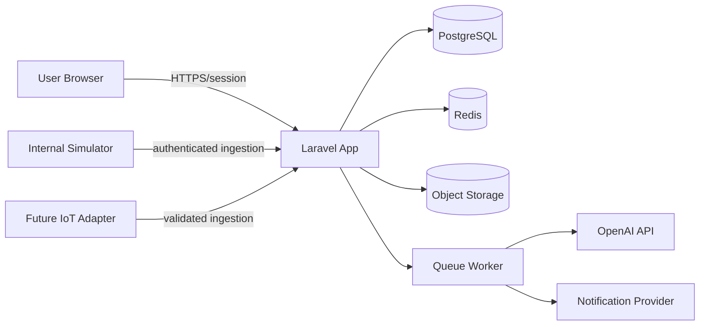

# Architecture Proposal

## Style

Laravel modular monolith with clear presentation, application, domain, infrastructure, authentication/authorization, AI integration, and observability boundaries.

## Modules

Identity/access; farms/locations; ponds; species; cultivation cycles; growth; water quality; feeding/feed stock; health/mortality; reminders/notifications; pond status; prediction; harvest; finance; reports; AI; simulator; IoT contract; audit logs.

## Initial data model

`users`, `farms`, `farm_memberships`, `locations`, `ponds`, `fish_species`, `cultivation_cycles`, `growth_samples`, `water_quality_records`, `feeding_records`, `feed_stocks`, `health_observations`, `mortality_records`, `reminders`, `notifications`, `harvest_predictions`, `harvests`, `expenses`, `revenues`, `ai_analyses`, `ai_analysis_sources`, `audit_logs`.

Every measurement retains value, unit, timestamp, source, actor/device, and validation status. `cultivation_cycles` are immutable historical boundaries for pond reuse.

## Data flow and trust boundaries

The browser, simulator, IoT payloads, uploaded files, and AI output are untrusted. AI has no direct database, command, or mutation access.

## Local Docker proposal

Services: `aquagrow-web`, `aquagrow-worker`, `aquagrow-scheduler`, `aquagrow-db`, and `aquagrow-redis`. Use an internal network for database/Redis. Proposed host web port is `8090`; PostgreSQL remains unpublished unless explicitly needed. Names, volumes, and database identifiers use the `aquagrow_` prefix.

## Production proposal

Web app, queue worker, scheduler, PostgreSQL, Redis, object storage, TLS reverse proxy, structured logs, error tracking, uptime monitoring, alerts, backup, restore drill, and recovery runbook. Load balancing and CDN are deferred until measured need exists.
