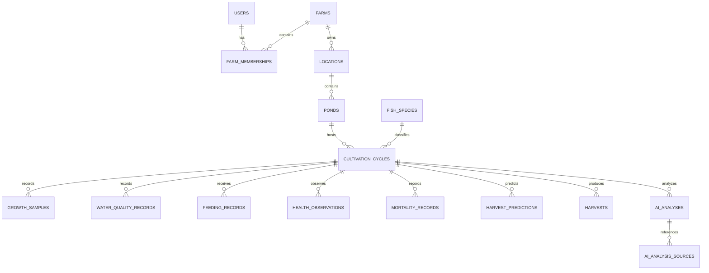

# Initial ERD

# Farm slice

`farms` owns tenant identity (`name`, globally unique `slug`, IANA `timezone`,
and allowlisted `currency`). `farm_memberships` joins users to farms with an
enum-backed role and unique `(farm_id, user_id)`. Foreign keys cascade only
when a farm/user is removed; application policy protects farm operations.

## Location and pond slice

`locations` belongs to a farm and has a farm-local unique slug. `ponds` stores
an explicit `farm_id` and references `(location_id, farm_id)` through a
PostgreSQL composite foreign key, preventing cross-farm relationships. Pond
measurements are nullable canonical metric values; empty does not mean zero.
